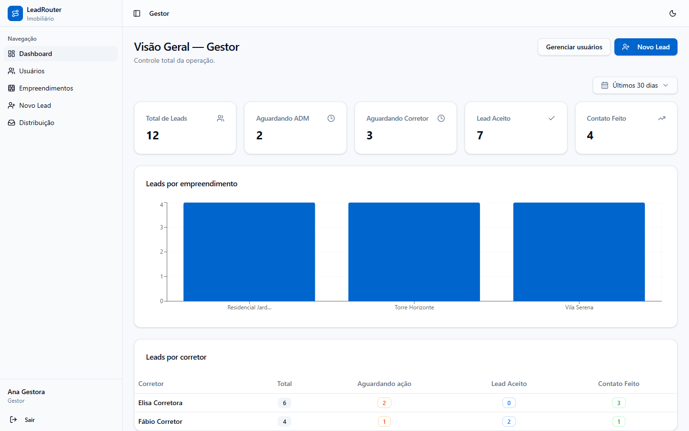
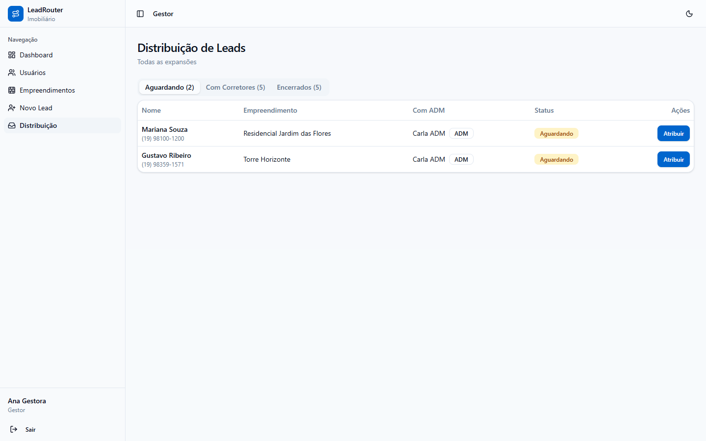
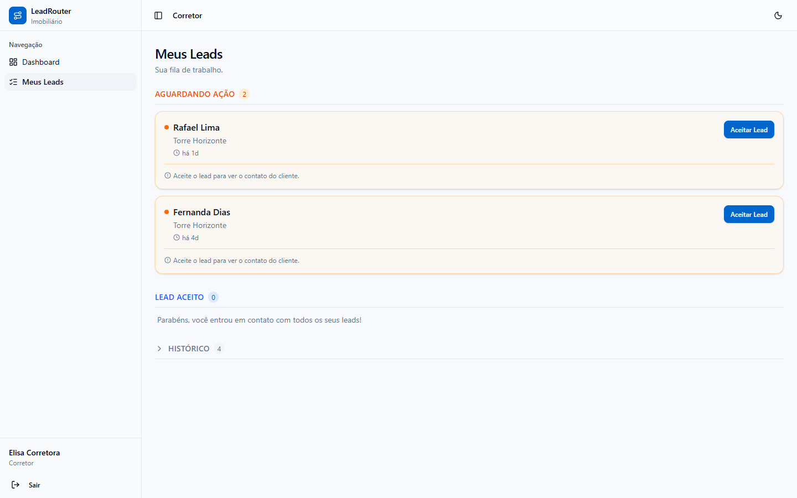
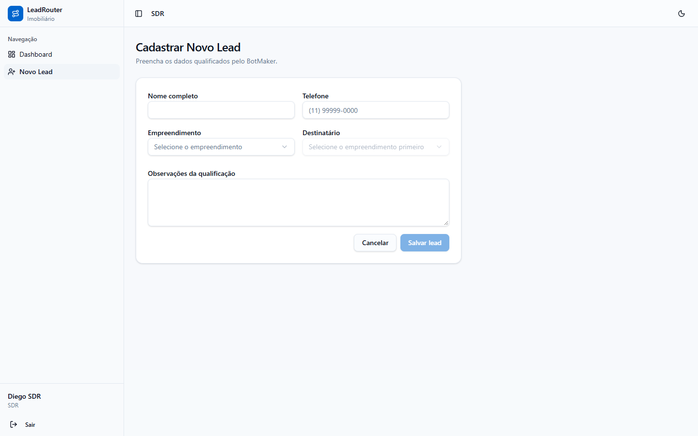
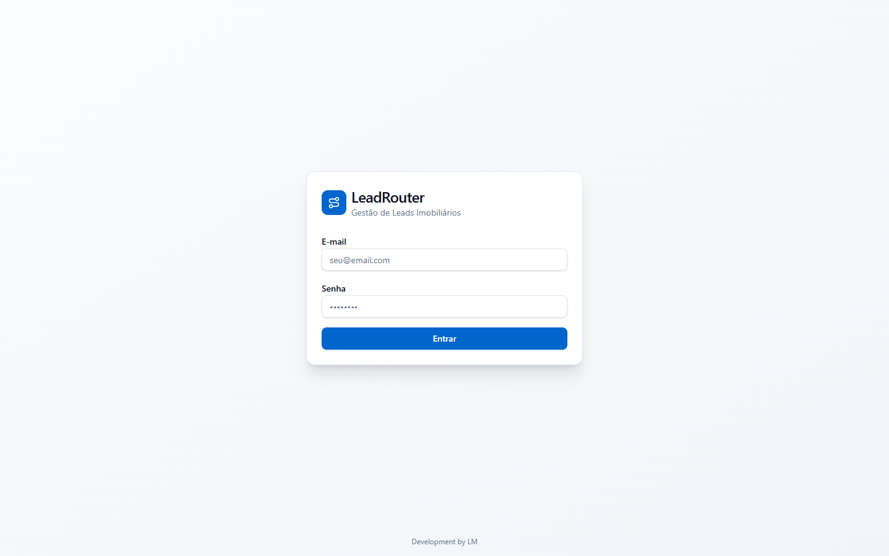
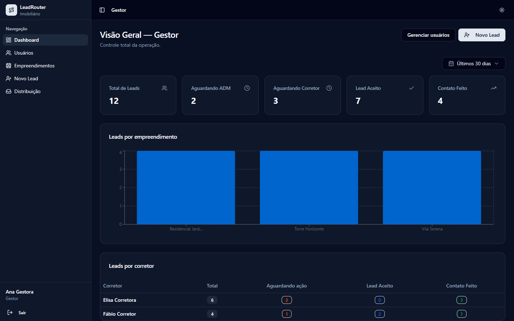

# LeadRouter

CRM de **distribuição de leads imobiliários**: leva o cliente interessado do primeiro contato até o corretor certo, com uma fila clara para cada pessoa da equipe e painéis diferentes por perfil.

**No ar:** https://tanstack-start-app.lucas-mendes-044.workers.dev · deploy automático a cada push na `main`.



---

## O problema

Na operação de vendas, o lead qualificado pelo bot (BotMaker) passa por várias mãos: SDR, ADM de expansão e corretor. Sem uma ferramenta própria para essa passagem:

- lead **se perdia entre conversas** e ninguém sabia com quem ele estava;
- o mesmo lead podia ser **trabalhado por dois corretores**, ou por nenhum;
- o gestor não tinha **visão de volume** por empreendimento e por corretor;
- o contato do cliente circulava antes de alguém **assumir** o atendimento.

## A solução

Um fluxo com dono definido em cada etapa:

```
SDR cadastra o lead qualificado ──► escolhe o destino (filtrado pelos empreendimentos dele)
   ├─ direto para um Corretor ─────────────► "Aguardando ação"
   └─ para um ADM de Expansão ─► distribui ─► Corretor (ou repassa a outro ADM)

Corretor ─► "Aceitar lead" (só então vê o telefone) ─► "Contato feito" ou "Número inválido"
```

| Perfil | O que vê e faz |
|---|---|
| **Gestor** | Visão total, gerencia usuários e empreendimentos, reatribui qualquer lead |
| **Coordenador** | Métricas dos seus empreendimentos (somente leitura) |
| **ADM de Expansão** | Recebe leads do SDR e distribui para os corretores dos seus empreendimentos |
| **SDR** | Cadastra leads e escolhe o destinatário |
| **Corretor** | Fila do dia: aceita o lead e registra o resultado do contato |

| Distribuição (ADM / Gestor) | Fila do corretor |
|---|---|
|  |  |

| Cadastro pelo SDR | Login |
|---|---|
|  |  |



> Os prints usam dados de demonstração: nomes, telefones e empreendimentos são fictícios.

---

## Stack

| Camada | Tecnologia |
|---|---|
| Linguagem | TypeScript ~5.8 |
| Framework | **TanStack Start** (React 19, SSR) · TanStack Router (rotas por arquivo) · TanStack Query |
| UI | Tailwind CSS v4 · shadcn/ui (Radix) · Recharts · lucide-react |
| Build | Vite 7 |
| Runtime e pacotes | **Bun** 1.3 |
| Hospedagem | **Cloudflare Workers** (assets estáticos + SSR no Worker) |
| CI/CD | GitHub Actions: typecheck → lint → build → `wrangler deploy` |

## Como rodar

```bash
bun install
bun run dev        # http://localhost:5173
bun run build      # build para o Cloudflare Workers
```

O banco começa vazio. Para criar o primeiro gestor, rode no console do navegador o trecho da seção *Criando o primeiro usuário* do [`CLAUDE.md`](CLAUDE.md). Os demais usuários são criados pela tela **Usuários**.

---

## Decisões técnicas

### 1. Protótipo navegável primeiro, banco depois
A versão atual guarda tudo no `localStorage` do navegador. Foi uma escolha consciente para **validar o fluxo com a equipe** (perfis, filas, regras de visibilidade) antes de pagar o custo de backend. O roteiro de produção já está definido: Cloudflare D1 + Drizzle ORM para os dados, Clerk para autenticação e R2 para arquivos, tudo dentro da camada gratuita para ~50 usuários.

> ⚠️ Por isso, hoje as senhas ficam em texto puro e os dados vivem só no navegador de quem usa. Isso está documentado como limitação conhecida e é resolvido na migração para Clerk e D1.

### 2. Schema versionado no `localStorage`
Cada coleção (usuários, leads, empreendimentos) tem uma chave de versão. Quando o formato muda no código, o dado antigo é descartado no próximo carregamento, em vez de quebrar a tela com um objeto incompatível. As chaves mantêm o prefixo `leadflow_` do nome antigo do projeto **de propósito**: renomeá-las apagaria os dados de quem já usa o app.

### 3. Contato revelado só no aceite
O telefone do cliente só aparece depois que o corretor clica em **Aceitar lead**. Isso registra quem assumiu o atendimento e evita contato duplicado.

### 4. Visibilidade por empreendimento
ADM, Coordenador e Corretor são vinculados a empreendimentos (`empreendimentoIds`). Cada tela filtra por esse vínculo: o ADM só distribui para corretores que compartilham os mesmos empreendimentos, e o SDR só vê destinatários do empreendimento escolhido. O Gestor não tem vínculo e vê tudo.

### 5. Regra defensiva na fila do corretor
Um lead com status `aguardando` que já tem corretor preenchido também aparece na fila desse corretor. Dado inconsistente fica **visível**, não some.

### 6. Um painel por perfil
Cada papel tem um dashboard próprio em `src/features/dashboards/`, em vez de uma tela única cheia de condicionais. Cada perfil vê só as métricas que usa.

### 7. Deploy sem `@cloudflare/vite-plugin`
Com o plugin, o TanStack Start gerava um manifesto apontando para um módulo virtual do modo de desenvolvimento, e a produção abria **em branco**. Sem ele, o build gera `dist/server/server.js` com o manifesto correto, e o `wrangler` empacota as dependências no deploy.

### 8. CI que barra código quebrado
O pipeline roda `tsc --noEmit` e o ESLint antes do build. Erro de tipo ou de hooks (como um hook chamado condicionalmente) não chega à produção.

---

## Estrutura

```
src/
├── routes/                 # login, /app (layout), dashboard, novo lead, distribuição, meus leads, usuários, empreendimentos
├── features/dashboards/    # um dashboard por perfil
├── components/             # sidebar, componentes compartilhados (StatCard, StatusBadge) e ui/ (shadcn)
└── lib/                    # auth (contexto), mock-data (CRUD no localStorage), utilitários
.github/workflows/          # deploy.yml
```

Guia completo do projeto (status, cores, modelo de dados, roteiro de produção) em [`CLAUDE.md`](CLAUDE.md).
